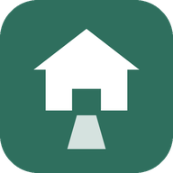
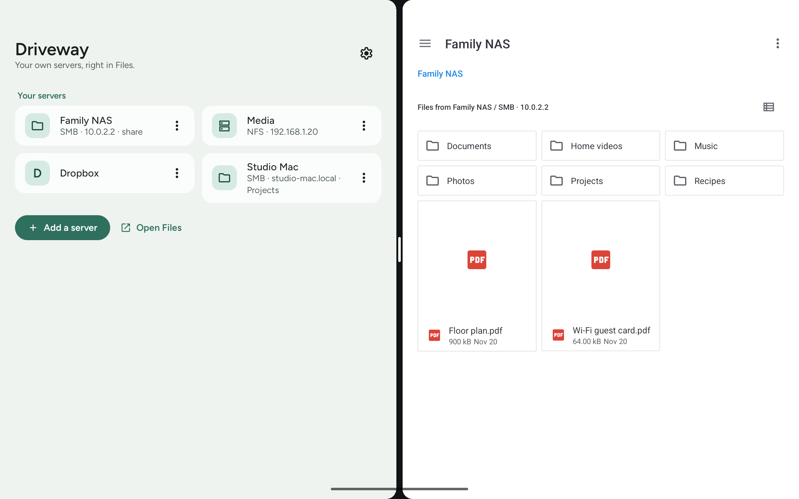
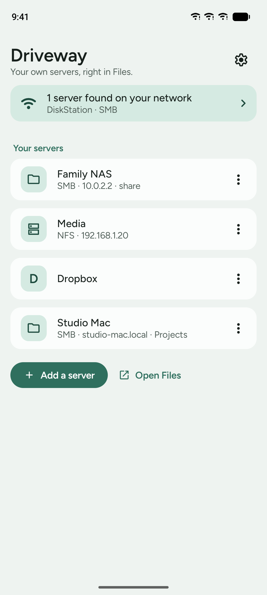
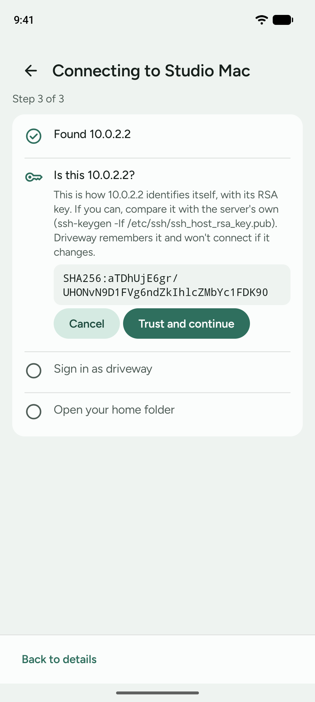
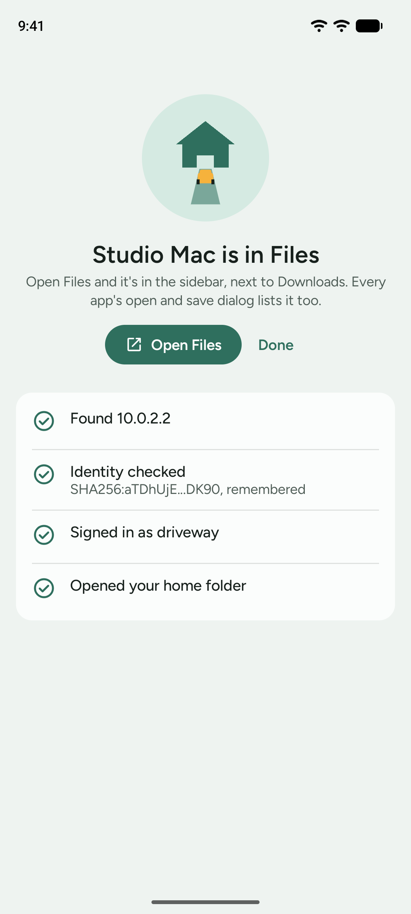
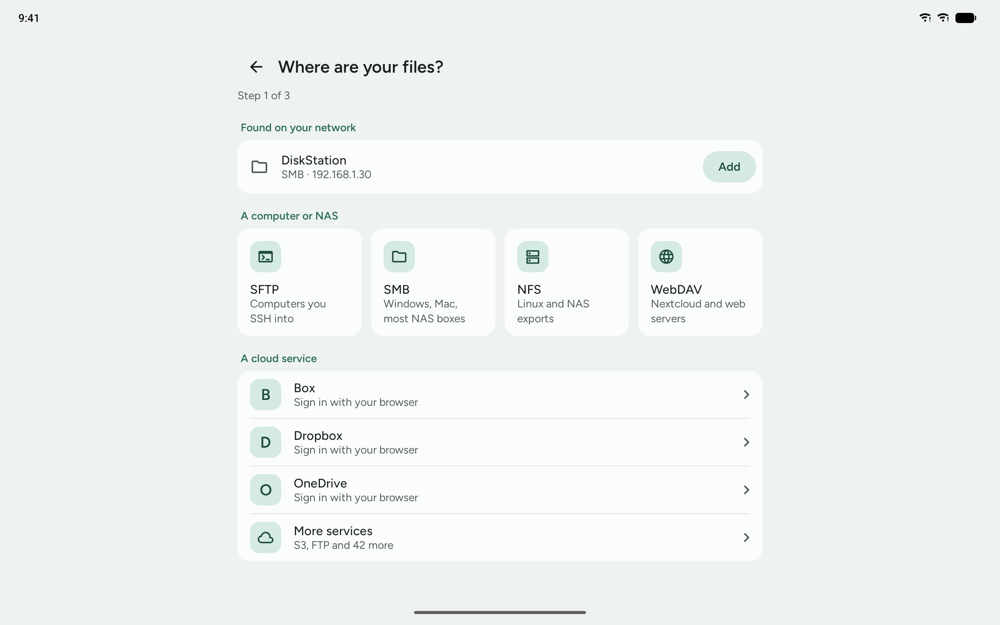
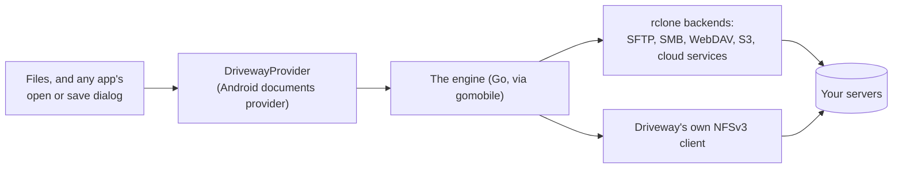

<p align="center">
  
</p>

<h1 align="center">Driveway</h1>

<p align="center"><b>Your own servers, right in Files.</b></p>

<p align="center">
  Driveway puts your file servers in the Files app and in every app's open and save dialogs,
  on Android phones, tablets and Googlebooks.
</p>

<p align="center">
  <a href="../../releases/latest"><b>Download the latest release</b></a>
  &nbsp;·&nbsp; <a href="https://merrimentlabs.com/driveway">merrimentlabs.com/driveway</a>
  &nbsp;·&nbsp; <a href="https://merrimentlabs.com/privacy/driveway">Privacy</a>
  &nbsp;·&nbsp; <a href="#install">Install</a>
</p>

<p align="center"><sub>Android 14 or newer · phones, tablets and Googlebooks · connects only to the servers you add, and to GitHub when it checks for updates · Apache License 2.0</sub></p>

<p align="center">
  
</p>

## What it does

Add a server once, and its folders sit in the Files sidebar beside Downloads. Open a
document, play a video, or save a drawing straight to the computer down the hall, from any
app that opens or saves files.

- **The ways servers share files.** SFTP for any computer you can reach over SSH, SMB for
  Windows and Mac file sharing and most network storage, NFS version 3, and WebDAV. Under
  More services: S3-style object storage, FTP, and most other services rclone supports, each
  asking only for what it needs to connect.
- **Cloud services you sign in to.** Dropbox and OneDrive sign in on their own page in your
  browser. So does Box, in the releases published here. Google Drive and Google Cloud Storage
  connect with a service account key, premiumize.me with an API key, and Jottacloud with a
  login token. Services Driveway can't connect to aren't listed.
- **Adding a server shows its work.** A checklist ticks through each step (found, identity,
  signed in, folder opened), stops at the one that fails with the fix right there, and ends
  with the server in Files.
- **Files open as you read them.** A video seeks and a long PDF jumps to a page without
  downloading the whole file first.
- **Saves are whole or not at all.** Driveway keeps a copy of what you save until the server
  has it, and replaces the old file only once the new one has fully arrived. If the
  connection drops, the server in Driveway and a notification offer Try again.
- **It knows your servers.** Servers on your network that announce themselves are found for
  you. For SFTP, Driveway can make a key for you, and it remembers each server's identity and
  refuses one that answers differently.

Driveway reaches the servers your device can reach: on your network, or through a VPN. It
doesn't make a server at home reachable from outside on its own.

## A look around

<table>
  <tr>
    <td width="33%"></td>
    <td width="33%"></td>
    <td width="33%"></td>
  </tr>
  <tr>
    <td>Your servers, one row each. Tap one to open it in Files.</td>
    <td>The first time, an SFTP server's identity is yours to check.</td>
    <td>Then it's in Files, and in every app's open and save dialogs.</td>
  </tr>
</table>

<p align="center">
  
</p>

Driveway works with a keyboard as well as touch (Tab, Enter and Escape on every screen; the
Menu key, a right-click or a long press opens a server's menu), with TalkBack, and at large
text sizes. The details are in [docs/LARGE-SCREEN-A11Y.md](docs/LARGE-SCREEN-A11Y.md). The
screenshots come from an emulator, against the test servers described below.

## Your data

Driveway has no account, no ads, no analytics and no crash reporting, and sends nothing to
Merriment Labs. What it contacts:

- **The servers you add**, and only with the requests you make through Files and other apps.
- **Your local network**, to find file servers that announce themselves. That stays on your
  network.
- **A cloud service's sign-in and API hosts, when you connect that service**: for example
  `www.dropbox.com` and `api.dropboxapi.com`, `login.microsoftonline.com` and
  `graph.microsoft.com`, `account.box.com` and `api.box.com`.
- **`api.github.com`**, only when you tap Check for updates in Settings, or about once a week
  if you turn on Check weekly (off until you do). It asks for the latest release's version
  number and sends nothing about you or your device; a newer version opens the release page
  in your browser.

The servers you add, with their passwords, keys and sign-in tokens, are stored on your device,
encrypted with an Android Keystore key, and left out of Android backup. While you save, a copy
of the file stays on the device until the server has it. The
[privacy policy](https://merrimentlabs.com/privacy/driveway) has the details.

## Install

Download `driveway-<version>.apk` from the [latest release](../../releases/latest) and open it
on your device. It needs Android 14 or newer. Android asks you to allow installs from your browser or
file manager first, because the app doesn't come from a store; that is the whole difference.
The release key's certificate SHA-256 is

`C5:19:F7:89:47:10:A0:7D:A2:F0:18:88:7C:93:9F:A6:55:27:9F:4C:56:B2:39:F3:DB:9F:3F:D0:70:EC:07:9E`

which `apksigner verify --print-certs driveway-<version>.apk` prints as

`c519f7894710a07da2f018887c939fa655279f4c56b239f3db9f3fd070ec079e`

The easy check, from a clone of this repository, is `scripts/release.sh --verify driveway-<version>.apk`:
it verifies the signature and compares the certificate for you. Each release also lists
the file's SHA-256 in `SHA256SUMS`. Every release is signed with that key, so a new one installs
over the old. To hear about new versions, turn on Check weekly in Settings, watch this
repository's releases, or add it to an updater such as
[Obtainium](https://github.com/ImranR98/Obtainium).

## How it's built



**A documents provider.** Android's Files app and every open and save dialog list storage
through documents providers. `DrivewayProvider` is one: each server is a root, and a document
is a path on it. A listing answers at once with what it has and fills in when the server
replies, because Files stops a provider that takes too long; each call Files waits on has one
deadline inside the time Files allows. Reads stream the range the app asks for. A save is
staged on the device, uploaded under a temporary name beside the original, checked, and
renamed over it. A foreground service keeps a save or copy going behind another app.
[docs/DESIGN.md](docs/DESIGN.md) has the whole design.

**rclone, compiled in.** The file engine is [rclone](https://rclone.org) v1.75.1, built into
the app with gomobile for the two chips Android devices use (x86_64 and arm64). The app hands
rclone each server's settings directly; rclone never reads a config file. Errors come back
with a category, and the app turns them into sentences. rclone has no NFS client, so Driveway
adds one (`engine/nfs`): NFSv3 over TCP on
[go-nfs-client](https://github.com/willscott/go-nfs-client).

**Signing in to cloud services.** rclone's own sign-ins borrow app registrations built into
rclone, which an app shipped to other people shouldn't do. So Driveway runs the browser
sign-in itself for the services it has its own registrations with: Dropbox and Microsoft
(OneDrive) use PKCE with no secret in the app, and their public client IDs are in
`engine/pkce.go`, so a build from this source signs in to them as Driveway. Box has no
sign-in for apps that can't keep a secret, so its registration needs a client secret. That
secret isn't in the repository: `build.sh` reads it from a file outside it. The releases here
sign in to Box with one tap, and so carry the secret, where anyone can read it out of the APK
(rclone ships its own Box secret the same way; [SECURITY.md](SECURITY.md) says what that
risks). A build of your own connects to Box with an app's settings file instead, or with one
tap if you supply your own Box registration ([CONTRIBUTING.md](CONTRIBUTING.md)). A sign-in comes back to a loopback
receiver that holds both `127.0.0.1` and `[::1]`, or refuses to start. Services that would
need a borrowed registration and have no other way in are hidden until they have one. A fork
that ships to others should register its own apps ([CONTRIBUTING.md](CONTRIBUTING.md)).

**A license gate.** Every build lists the Go modules compiled in and fails if any license is
outside a permissive set (MIT, BSD, Apache, ISC and the like). MPL-2.0 components are allowed
only unmodified. One LGPL dependency of the SMB client is replaced by a pass-through of our
own (`engine/third_party/sddl`).

**No Gradle.** `build.sh` builds the app with the Android SDK's own tools (aapt2, javac, D8,
zipalign, apksigner), plus an App Bundle through bundletool. Go, gomobile, rclone, the NDK,
bundletool, the R8 jar that D8 runs from, and the Docker test images are pinned to exact
versions (the SDK's build-tools are not), and `javac -Xlint:all` runs with warnings as errors.

**Tests.** `test/servers` runs SFTP, SMB, NFS, WebDAV, S3 and FTP servers in Docker,
and `./build.sh test` runs the engine's checks against all of them: 188 Go tests (with 89
subtests), including a fake backend that fails at every step of a save, and an NFS check that
an operation given up on mid-flight changes nothing afterward. Engine statement coverage is
measured by `./build.sh cover`. 594 plain-Java checks cover the service catalog, the Server
field and the address check, the New labels, error messages, log redaction, the update check, and the wording rules every string
follows. On an emulator, a debug-only harness drives the app through Android's documents API
(`tools/harness.sh`), a screen walk checks 26 screens for accessibility problems
(`tools/screens.sh`), and the browser sign-ins run end to end against a stand-in provider
(`tools/signin-harness.sh`). CI runs the build and the Docker-backed tests
on every pull request. Driveway has also been checked by hand on phone, tablet and
large-screen emulators and on a Googlebook. [docs/TESTING.md](docs/TESTING.md) has the
commands.

**How this is built.** I'm a product manager who builds. I decide what each app does, how it
should feel, and what it leaves out. The code is written with AI coding agents that I direct,
inside a process I designed: every change has to pass unit tests, a license audit and an
independent review before it lands, and I check the result on real devices before anything
ships. This repo starts from a clean snapshot of my private working repo, and each change after
that is carried over as its own commit. I write about how the process works at
[jessejohnston.ai](https://jessejohnston.ai).

## Build it yourself

You need Linux on x86_64 with JDK 21 (the version the build and CI are tested with), Python 3,
unzip, `ssh-keygen`, and an Android SDK with build-tools and `cmdline-tools/latest` (set
`ANDROID_HOME`; licenses accepted with `sdkmanager --licenses`). Docker runs the test servers.

```sh
./build.sh fetch     # once: Go, gomobile, go-licenses, the Android jars and the NDK
./build.sh debug     # build/Driveway-debug.apk, with the adb-only test harness
./build.sh unit      # the checks that need no servers
./build.sh test      # everything, against test servers it starts in Docker
./build.sh           # build/Driveway.apk, the release build
./build.sh bundle    # also build/Driveway.aab, an Android App Bundle
```

Debug builds are signed with a throwaway key the build makes in `~/.cache/driveway`, so they
work for anyone. Release builds are signed with the key in `~/.config/driveway/keystore.jks`,
which isn't in this repository; `./build.sh` asks for its password in the terminal, or takes it
from `DRIVEWAY_KEYSTORE_PASS`, and never reads it from a file. When there is no release keystore,
`DRIVEWAY_TEST_KEY=1 ./build.sh` signs a release build with the throwaway key instead. A build signed with one key can't update
an install signed with another. Releases are built from a clean checkout of their tag by
`scripts/release.sh`, which also writes `SHA256SUMS`; [docs/RELEASING.md](docs/RELEASING.md)
has the steps, including signing a build with your own key.

## Roadmap

Next:

- Signing in with your account to more services, where Driveway can do it with a registration
  of its own rather than borrowing rclone's.

Not planned:

- Syncing folders to the device. Driveway shows your servers where Android already looks for
  files, and stops there.
- An account or cloud of our own.
- Making a server at home reachable from the internet.

## Contributing

Issues are welcome. Driveway is maintained by one person, so there is no support promise.
Error messages are in Driveway's own words; [CONTRIBUTING.md](CONTRIBUTING.md#issues) says how to
get the technical detail behind one from the device's log (`adb logcat -s Driveway GoLog`).
Driveway takes passwords, API keys and tokens out of that log, but read it before you post it, and
remove any you still find, along with server names, addresses and anything else personal.
Pull requests are read; a change that fits is applied in the private working repository and
carried back here as its own commit, credited to you. [CONTRIBUTING.md](CONTRIBUTING.md) has the
details, and [SECURITY.md](SECURITY.md) says how to report a security problem privately.

## License

Driveway is licensed under the [Apache License 2.0](LICENSE). If you redistribute it or build on
it, keep the [NOTICE](NOTICE) file with your copy; it reads:

```
Driveway
Copyright 2026 Jesse Johnston
Published by Merriment Labs (https://merrimentlabs.com)
```

The license gives no permission to use the Driveway or Merriment Labs names (section 6).

The engine is built from rclone and about 215 other Go modules, listed with their licenses in
[THIRD_PARTY_NOTICES.md](THIRD_PARTY_NOTICES.md). The app shows each one's full license text under
Settings, About, Open-source notices, with the source link for the MPL-2.0 components, and the
Figtree typeface (SIL Open Font License) and Material Symbols icons (Apache-2.0) it uses. Box,
Dropbox and OneDrive are named in text only; no company's logo ships
([docs/BRAND-MARKS.md](docs/BRAND-MARKS.md)).

## About

> Driveway is made by [Merriment Labs](https://merrimentlabs.com), a one-person Android
> studio run by Jesse Johnston. Questions, bugs and ideas are welcome at
> [merrimentlabs.com/contact](https://merrimentlabs.com/contact) or
> hello@merrimentlabs.com.
>
> Copyright 2026 Jesse Johnston. Published by Merriment Labs.
